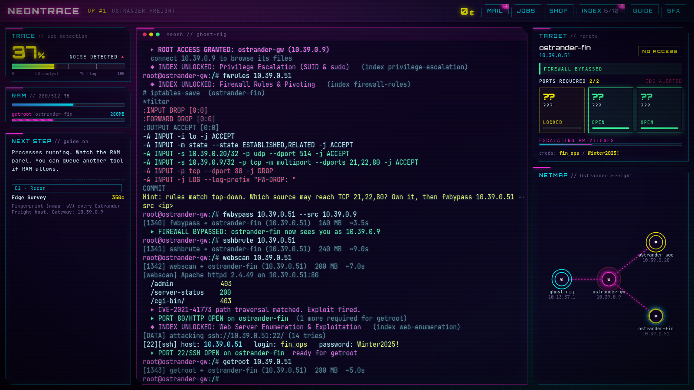

# NEONTRACE

**Breach. Get paid. Don't get traced.**

A neon cyberpunk hacking roguelite in the spirit of Hacknet. Take contracts from your fixer Vex, breach simulated corporate networks with real attack concepts, exfiltrate the goods, get paid, upgrade your rig and fill the Index, an in-game codex that explains every technique from both sides of the wire.

Everything is simulated. No command ever touches a real network.



## Play it

### In a browser (fastest)

Needs [Node.js](https://nodejs.org) 20 or newer.

```bash
cd neontrace
npm install
npm run dev
```

Open <http://127.0.0.1:1420>. Your progress saves automatically in the browser.

Handy URL options:

| URL | What it does |
|---|---|
| `?fresh` | Wipe the save and start over |
| `?seed=1234` | Play a specific network seed |
| `?demo` | Attract mode: the game plays a contract by itself |
| `?tutorialdemo` | Attract mode: the game plays the training sim by itself |

### As a PC app (Tauri)

Needs Node.js plus [Rust](https://rustup.rs) (latest stable) and the [Tauri prerequisites](https://v2.tauri.app/start/prerequisites/) for your OS. On Windows that is the Microsoft C++ Build Tools and WebView2 (already on Windows 10/11).

```bash
cd neontrace
npm install
npm run tauri:dev      # run the desktop app with hot reload
npm run tauri:build    # build an installer
```

Installers land in `src-tauri/target/release/bundle/`:

- Windows: `nsis/NEONTRACE_0.1.0_x64-setup.exe` and `msi/NEONTRACE_0.1.0_x64_en-US.msi`
- macOS: `dmg/NEONTRACE_0.1.0_*.dmg`
- Linux: `deb/*.deb` and `appimage/*.AppImage`

### Download a build from GitHub Actions

The workflow in `.github/workflows/neontrace.yml` builds Windows, macOS and Linux installers on every push to `main` that touches `neontrace/`, and on pull requests. Open the workflow run on GitHub and download `neontrace-windows` from the Artifacts section. Pushing a tag like `neontrace-v0.1.0` also creates a draft GitHub Release with the installers attached.

## How to play

### Training sim (first launch)

A new profile starts in Vex's training sim, a safe three-box network (`dojo-gw`, `dojo-vault`, `dojo-cache`). Real contracts stay locked until you finish it. Vex walks you through one command at a time and the game checks each one before moving on:

1. Shell basics: `help`, `pwd`, `ls`, `cd`, TAB completion, history (up arrow), pipes and `grep`, `man`.
2. `mail` and the `jobs` board.
3. `nmap`, `connect`, `scan`, `dc` and the network map.
4. A twist: crack the vault head on and the firewall drops you. Then `fwrules`, own the trusted gateway, and pivot with `fwbypass`.
5. RAM: run `sshbrute` and `webscan` in parallel.
6. The trace: Vex spikes it to 78% so you see what 50, 75 and 100% mean, then you read `index the-trace`.
7. `getroot`, `scp` a file home, `grep` an auth log for the intruder, `submit` the drill and get paid.
8. `rm` the logs, `dc`, and spend your pay in the `shop`.
9. A final exam with no hand-holding: bring home the graduation key from the third box. Type `hint` if you get stuck.

The trace is capped at 99% in the sim, so nothing you do there can end the run. Typos get a "did you mean" and a reminder of what the step wants. When you graduate, Vex points you at the Workshop. Replay any time with `tutorial` or the TRAIN button (your real op is saved and restored), or `tutorial skip` to leave a replay early.

### The breach loop

The **NEXT STEP** panel on the left always shows what to do and the exact command. Click the command to have it typed for you, or type it yourself. Turn the guide off with the GUIDE button once you know the ropes.

The core loop of a breach:

1. `nmap -sV <ip>` fingerprints a host: open ports, service versions, firewall.
2. `connect <ip>` then `scan` reveals the hosts linked behind it.
3. `fwrules <ip>` reads a firewall's iptables rules. Find the source it trusts, own that box, then `fwbypass <ip> --src <trusted-ip>` to pivot through it.
4. Crack the required ports: `sshbrute` (22), `webscan` (80), `ftploot` (21, from the shop). Each runs as a process with a progress bar and a RAM cost, so plan what runs in parallel.
5. `getroot <ip>` once enough ports are open. Now you can `ls`, `cat`, `grep`, `rm` and `scp` on the box.
6. Watch the **TRACE** meter. Every noisy action adds heat, and hanging around a box that has noticed you keeps it climbing. Disconnecting does not reset it; it only cools while you lie low. Scrubbing logs with `rm /var/log/*` on a box you own clears its alert. At 100% you are traced: the op ends, but your credits, tools and Index carry over to the next op.

Other commands: `mail`, `jobs`, `submit <job> <answer>`, `shop`, `buy <item>`, `index [entry]`, `tools`, `man <tool>`, `ps`, `kill <pid>`, `status`, `hint`, `help`. Pipes work (`cat /var/log/auth.log | grep Failed | wc -l`), TAB completes commands, hosts and files, and the up/down arrows walk history.

### What's in this build

- **3 contracts per op:** Recon (fingerprint the network), Breach & Retrieve (pull `payroll.db` from a firewalled finance server), Log Analysis (find the intruder's IP in an SOC auth log).
- **Seeded networks:** each op generates a new company with its own IPs, passwords and attacker. Finish all jobs and `jackout` to extract with a stealth bonus and roll a new op.
- **Breach tools:** nmap, sshbrute, webscan, fwbypass, getroot, and ftploot from the shop.
- **Shop (permanent upgrades):** ftploot, +512 MB RAM, a better wordlist (sshbrute 2x faster), and a QUIET mod (sshbrute makes half the heat).
- **The Index:** 10 entries (port scanning, SSH credential attacks, weak/default creds, web exploitation, privilege escalation, covering tracks, log analysis, the trace, firewall rules and pivoting, anonymous FTP). Each has a Real World, In Game and Detection & Defense section plus MITRE ATT&CK IDs. Entries unlock the first time you use a technique.

### Coming later

Python scripting via Pyodide, the **Workshop** (build your own scanners, crackers, log watchers and IDS rules and use them like shop tools), proxies, deeper privilege escalation, blue-team contracts and more factions. The tool system is already built around one shared interface (`ToolDef` in `src/engine/tools.ts`), so homemade tools will plug into the same RAM bar, progress bars and Index links. Type `workshop` in game for a preview.

## Project layout

```
neontrace/
  src/engine/        game logic, no DOM (fully unit tested)
    parser.ts        command line parsing: quotes, escapes, pipes, flags
    vfs.ts           in-memory filesystem per host
    network.ts       seeded network generator (hosts, ports, firewall, logs)
    tools.ts         common ToolDef interface + breach tools + registry
    tutorial.ts      training sim steps and their checks
    game.ts          state, commands, process manager, trace meter, contracts, hints, saves
    content/         Index entries, contracts, shop items (plain data)
  src/ui/            xterm.js line editor, panels, netmap, DOM patcher, synth audio
  src/main.ts        wires the engine to the UI
  src-tauri/         Tauri 2 desktop shell
  tests/             vitest suites: parser, network sim, breach logic, training sim
```

## Tests

```bash
npm test          # vitest: parser, network sim, breach logic, training sim steps, full playthroughs
npm run build     # typecheck + production web build
```
